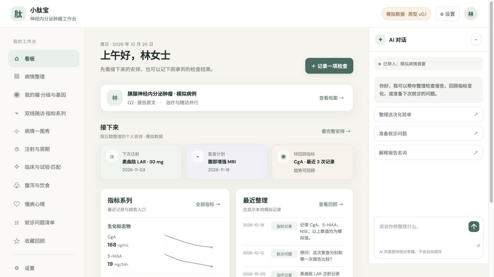

# 小泌宝 · 神经内分泌肿瘤工作台

神经内分泌和肾上腺肿瘤（NET）患者工作台：分级档案、生化+影像双线随访、SSA 注射与 PRRT 治疗事件、基因/病理档案与临床研究查询状态

当前状态：M0 骨架 + M1 调研/SPEC 已完成，M2 原型 v0.1.5 可预览；真实业务尚未实现，G2 未签认。交互原型入口：[prototypes/v0.1/index.html](prototypes/v0.1/index.html)。原型记录：[PROTOTYPE-REVIEW](docs/PROTOTYPE-REVIEW.md)，交互路径：[INTERACTION-DESIGN](docs/INTERACTION-DESIGN.md)，HVT 审核：[HVT-REVIEW](docs/HVT-REVIEW.md)。项目提示词：[DESIGN-PROMPT](docs/DESIGN-PROMPT.md)，专用通用提示：[NEW-CANCER-WORKBENCH](prompts/NEW-CANCER-WORKBENCH.md)，需求：[BRIEF](docs/BRIEF.md)，规格：[SPEC](docs/SPEC.md)，先读 [AGENTS](AGENTS.md)。


<details>
<summary><b>? 疾病概要</b>（定义 · 规范与指南 · 治疗全景 · 发展趋势；看板 ? 图标弹窗待各仓自行迭代落地）</summary>

**定义**：神经内分泌和肾上腺肿瘤（NET）：按 WHO 消化系统肿瘤分类第 5 版分级（G1 ≤2% / G2 3–20% / NET G3 >20% 分化良好 vs NEC 低分化）；本仓围绕分级档案、生化+影像双线随访与治疗事件整理病程。

**医学资料规范和指南情况**：NCCN Neuroendocrine and Adrenal Tumors **3.2025**（官网核实，检索日 2026-10-25）；CSCO《神经内分泌肿瘤诊疗指南》2025 版（2025-04 发布）。

**目前治疗全景概要**：生长抑素类似物注射线（奥曲肽 LAR 齐鲁首仿 2023、兰瑞肽均已上市）；依维莫司 / 舒尼替尼 / 索凡替尼 NMPA 获批（适应症口径见 SOURCES）；PRRT（177Lu-DOTATATE）国内未正式获批（先通 2025-04 受理）；手术亦为治疗事件之一。方案取舍由主管医生决定，本仓不载剂量。

**发展趋势**：NCCN 版本迭代（2.2025→3.2025）；PRRT 国内审批受理中（未核实获批）；新方向仅见于研究文献线索，本仓不载疗效信息。

以上为公开资料的整理性概要，不构成诊断或治疗建议；版本与出处详见 [SPEC](docs/SPEC.md) 医学口径基准与 SOURCES。
</details>

## M2 交互原型（模拟数据）

可直接打开 `prototypes/v0.1/index.html`。当前完成一张首页实渲截图（1280×720）；其余原型截图尚未取得。



原型含 11 个业务页、指标系列/翻转卡、一图秀指标选择窗口、治疗折叠卡、模拟试验匹配卡与设置页。大部分表单/保存/AI/真实检索仍是占位；交互路径走查、C1–C12 和窄宽实测未完成。详见 [PROTOTYPE-REVIEW](docs/PROTOTYPE-REVIEW.md)。

## 开发顺序

先共创 SPEC 与候选数据关系，再交付 HTML 交互工作台；由用户确认对应版本/模块后，复核 SCHEMA/API 并实现生产功能。当前 M2 原型尚未获用户视觉确认，因此不得进入正式业务实现。模型不依赖前端 Tab/流程。

## 当前能力

- 一个 DSH 工作台注册、认证的健康接口、版本展示与标准/大字切换。
- 已明确选择布局：business-first。business-first 使用 customFrame；模板不创建会话或复制聊天。需要 AI 协助时按官方合同接入原生 conversation 和会话管理。
- 无业务数据库、无演示患者、无真实密钥；所有业务页按确认 spec 逐项实现。

## 开发与本地验收

需要 Node.js 22+、Git、包管理器和可用 DSH Desktop；采用 SQLite 时另核验 node:sqlite 版本条件。宿主 peers 的范围仅是模板基线，请与目标 Desktop 实际依赖核对。

```bash
npm install
npm run check
npm run pack:check
npm pack
```

`npm run check` 只保证"能装"（语法 + 装包合同），第一天就该是绿的。`npm run audit` 管"还是不是家族里的一员"：版本三处一致、`lib/layout.js` 面板参数单一来源、检查链完整、文档与密钥卫生，**只看代码与文件，不看文档自述**。新项目刚生成时 audit 必然有 fail，那是待办清单；交付/发布前必须清零，存在 fail 不得发布（`npm run release:check` 一次跑完两者）。

跑的时间点：**每次改完**跑 `check`；**G2 原型确认后、写业务代码前**先跑一次 `audit`（这时缺的多是 `lib/layout.js`、`VERSION` 这类结构，越早补越便宜）；**交付/装机前**必须跑 `release:check`；**发布或投稿前**把 `npm run audit --json` 的 `xx/xx 通过 · N 失败 · M 待人工` 抄进 `docs/RELEASE.md` 的「家族一致性」一行。`✗` 是结构缺口（补齐，或在 `docs/DEV-REQUIREMENTS-<日期>.md` 写明偏离理由并由用户确认），`!` 是需人工判断的项（逐条给「已人工确认 / 确实没有」）。

`npm install` 可能按 npm 策略解析 peer；勿为消警告重复打包宿主 runtime。客户端本身是单文件；引入 TS/组件库后需添加构建步骤并保留单文件导出。

本地安装入口以当前 Desktop/CLI 帮助为准。安装后按 [docs/06-VALIDATION-AND-RELEASE.md](docs/06-VALIDATION-AND-RELEASE.md) 与官方自测完成真实 UI 验收，并填写 [docs/ACCEPTANCE.md](docs/ACCEPTANCE.md)。静态检查不代表已加载。

Logo 来源与使用限制见 assets/README.md。许可证、作者、仓库/发布策略由本项目维护者确认后填写；模板默认为 private/UNLICENSED。

感谢小x宝社区、DataElement 社区，以及 sam / hhx / 繁华的 ❤️ 贡献。

初始化来源记录见 `.dsh-wb-starter.json`。更新社区脚手架不会覆盖本项目；需要升级时先用相同确认配置在临时目录生成，再审阅差异。CLI 用法见 [docs/CLI-GIT.md](docs/CLI-GIT.md)。

## HTML先行与数据演进

业务开发前先交付HTML交互工作台原型、实际预览并由用户确认版本/hash和范围。数据设计先区分领域事实、流程状态和页面读模型，走查前端/流程变化、兼容与迁移；原型对象不直接作为表。见[规范](docs/14-HTML-AND-DATA-CONTRACT.md)。
